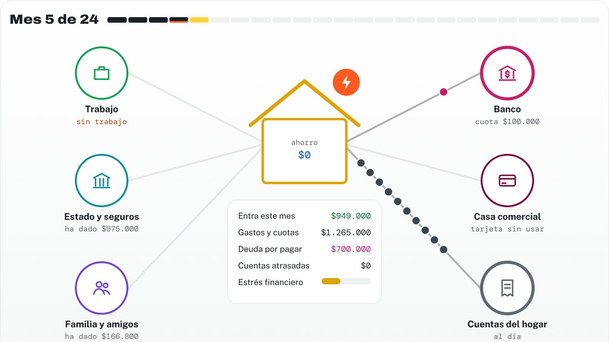
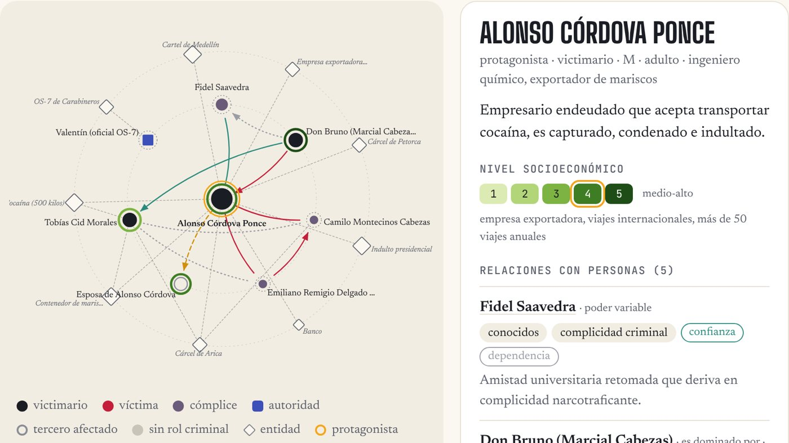

::: {.top-banner}
:::

::: {.language-switch}
[EN](tools.qmd) | [ES](tools-es.qmd)
:::

::: {.research-section}

# Interactive Tools

Research findings rarely reach the people who could use them. I build interactive web tools that turn evidence about social problems into something people can explore: change a condition, follow a mechanism, see what happens. They are meant for students, the general public, and people who make public decisions.

Each tool is a single web page that opens in any browser, with its code and data available on GitHub.

::: {.tool-card #economic-security-lab}
```{=html}
<a class="tool-preview" href="https://gonzalotr11.github.io/economic-security-lab/" aria-label="Open the Economic Security Lab"></a>
```

::: {.tool-tag}
Household economic insecurity · Interactive simulation · ES / EN
:::

### Economic Security Lab

Why is a household's monthly income not enough to know whether it is secure? The lab shows how shocks, savings, family support, debt and social protection interact, and why two households with the same income can face very different risks.

- **Learn:** the core idea, three layers of the problem, eight documented mechanisms, evidence, ways to measure it, and readings linked to the original articles.
- **Build a household:** add income, obligations and cushions; launch a shock and compare how much it hurts with and without protection.
- **The household over time:** a 24-month budget in Chilean pesos. When money runs short, the household turns to savings, family, the bank or a cash advance, and each option leaves consequences.
- **Step by step:** the same simulation animated month by month, with money flowing between the household and those who support it or charge it.

Amounts and probabilities are illustrative, calibrated with public references. The models explain mechanisms described in the literature; they are not estimates for real households.

[Open the lab](https://gonzalotr11.github.io/economic-security-lab/){.btn .btn-primary}
[Code on GitHub](https://github.com/gonzalotr11/economic-security-lab){.btn .btn-outline-primary}
:::

::: {.tool-card #mea-culpa-as-data}

```{=html}
<a class="tool-preview" href="https://gonzalotr11.github.io/mea-culpa-datos/" aria-label="Open the Mea Culpa, as data explorer"></a>
```

::: {.tool-tag}
Text as data · Relational databases · Teaching
:::

### Mea Culpa, as data

A relational database built from the subtitles of 121 episodes of *Mea Culpa*, a Chilean television series about real crimes. Each episode is broken down into 15 linked tables: characters, relationships and their emotional tone, places and objects, the sequence of events, and the structural conditions behind each case.

- Filter episodes by season, type of crime, causal mechanism, structural conditions, or themes.
- Follow each episode's narrative thread across six phases, from background to consequences.
- Explore the network of relationships around the protagonist, including power asymmetries and socioeconomic status.
- See the table rows behind each episode to understand how a story becomes relational data.

It was designed as teaching material for psychology and social science students learning to turn text into data. Character names are fictitious.

[Open the explorer](https://gonzalotr11.github.io/mea-culpa-datos/){.btn .btn-primary}
[Data and code on GitHub](https://github.com/gonzalotr11/mea-culpa-datos){.btn .btn-outline-primary}
:::

:::
