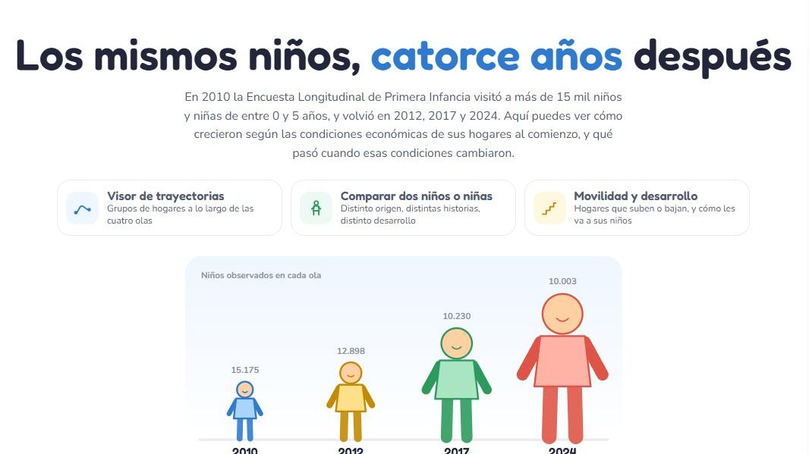

::: {.top-banner}
:::

::: {.language-switch}
[ES](tools.qmd) | [EN](tools-en.qmd)
:::

::: {.research-section}

# Herramientas interactivas

Los resultados de investigación rara vez llegan a quienes podrían usarlos. Desarrollo herramientas web interactivas que convierten evidencia sobre problemas sociales en algo que se puede explorar: cambiar una condición, seguir un mecanismo, ver qué ocurre. Están pensadas para estudiantes, para el público general y para quienes toman decisiones públicas.

Cada herramienta es una página web que se abre en cualquier navegador, con su código y sus datos disponibles en GitHub.

::: {.tool-card #economic-security-lab}
```{=html}
<a class="tool-preview" href="https://gonzalotr11.github.io/economic-security-lab/" aria-label="Abrir el Laboratorio de Seguridad Económica"></a>
```

::: {.tool-tag}
Inseguridad económica de los hogares · Simulación interactiva · ES / EN
:::

### Laboratorio de Seguridad Económica

¿Por qué el ingreso del mes no basta para saber si un hogar está seguro? El laboratorio muestra cómo se encadenan los golpes, el ahorro, el apoyo familiar, la deuda y la protección social, y por qué dos hogares con el mismo ingreso pueden enfrentar riesgos muy distintos.

- **Aprender:** la idea central, tres capas del fenómeno, ocho mecanismos documentados, evidencia, formas de medirlo y lecturas con enlace al artículo original.
- **Arma un hogar:** suma ingresos, obligaciones y colchones; lanza un golpe y compara cuánto duele con y sin protección.
- **El hogar en el tiempo:** un presupuesto de 24 meses en pesos chilenos. Cuando falta plata, el hogar recurre al ahorro, la familia, el banco o el avance en efectivo, y cada opción deja consecuencias.
- **Paso a paso:** la misma simulación animada mes a mes, con el dinero circulando entre el hogar y quienes lo sostienen o le cobran.

Los montos y probabilidades son ilustrativos, calibrados con referencias públicas. Los modelos explican mecanismos descritos en la literatura; no son estimaciones sobre hogares reales.

[Abrir el laboratorio](https://gonzalotr11.github.io/economic-security-lab/){.btn .btn-primary}
[Código en GitHub](https://github.com/gonzalotr11/economic-security-lab){.btn .btn-outline-primary}
:::

::: {.tool-card #infancias-en-trayectoria}

```{=html}
<a class="tool-preview" href="https://gonzalotr11.github.io/infancias-en-trayectoria/" aria-label="Abrir Infancias en trayectoria"></a>
```

::: {.tool-tag}
Primera infancia · Datos longitudinales · Movilidad
:::

### Infancias en trayectoria

¿Cómo crecen niñas y niños según las condiciones económicas de sus hogares, y qué pasa cuando esas condiciones cambian? La herramienta sigue a los participantes de la Encuesta Longitudinal de Primera Infancia (ELPI) en sus olas de 2010, 2012, 2017 y 2024.

- **Visor de trayectorias:** agrupa los hogares según su situación en 2010 y muestra cómo evolucionan el vocabulario, el ajuste emocional y conductual y el estrés parental.
- **Dos niños:** arma dos perfiles con distinto origen y distintos eventos (caída de ingreso, pérdida de empleo, salida de la pareja) y compáralos lado a lado.
- **Movilidad y desarrollo:** cómo se mueven los hogares entre quintiles de ingreso y cómo les va a los niños de hogares que suben, se mantienen o bajan.

Usa datos agregados de la ELPI. Sus limitaciones, como la ausencia de ponderadores y la salida no aleatoria del panel, están explicadas en la misma herramienta.

[Abrir la herramienta](https://gonzalotr11.github.io/infancias-en-trayectoria/){.btn .btn-primary}
[Código en GitHub](https://github.com/gonzalotr11/infancias-en-trayectoria){.btn .btn-outline-primary}
:::

::: {.tool-card #mea-culpa-como-datos}

```{=html}
<a class="tool-preview" href="https://gonzalotr11.github.io/mea-culpa-datos/" aria-label="Abrir el explorador Mea Culpa, como datos"></a>
```

::: {.tool-tag}
Texto como datos · Redes de relaciones · Docencia
:::

### Mea Culpa, como datos

*Mea Culpa* dejó 121 historias contadas con detalle: quiénes eran, cómo vivían, qué los unía y qué condiciones rodeaban sus vidas antes de un crimen grave. Este explorador las convierte en una base relacional de 15 tablas construida a partir de los subtítulos.

- **Recorridos:** hilos temáticos (violencia que escala en casa, abandono institucional, dependencia económica, infancias en riesgo, pobreza) con lo que se repite en cada uno.
- **Pregúntale al archivo:** arma una pregunta con palabras y mira qué casos la cumplen y qué otras condiciones los acompañan.
- **La red de cada episodio:** personas y entidades con su rol, nivel socioeconómico, tono afectivo y asimetrías de poder, junto al hilo narrativo en seis fases.
- **Archivo completo:** buscador y filtros, y las filas de cada tabla detrás de cada ficha.

Diseñada como material docente para estudiantes de psicología y ciencias sociales que aprenden a convertir texto en datos. Los nombres de las personas son ficticios.

[Abrir el explorador](https://gonzalotr11.github.io/mea-culpa-datos/){.btn .btn-primary}
[Datos y código en GitHub](https://github.com/gonzalotr11/mea-culpa-datos){.btn .btn-outline-primary}
:::

:::
